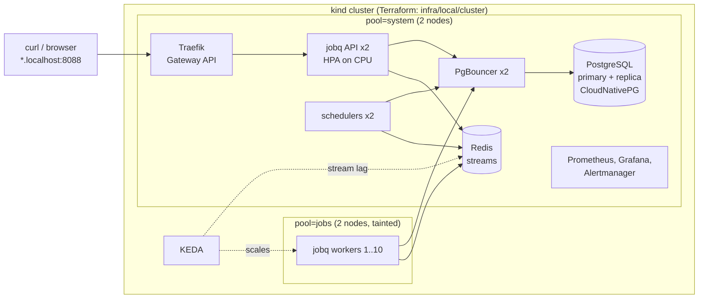

# Cloud-native platform for the jobq task scheduler

[](https://github.com/AnuragBhandary/Cloud-Native-Platform/actions/workflows/ci.yml)

[jobq](https://github.com/AnuragBhandary/Distributed-Job-Scheduler), my distributed job queue, run
the way production services run: on Kubernetes, created end to end by **Terraform**, packaged with
**Helm**, autoscaled on queue depth with **KEDA**, fronted by a **Gateway API** gateway, with
**PostgreSQL high availability** (CloudNativePG + PgBouncer), **Prometheus/Grafana** monitoring and
**SLOs with burn-rate alerts**. Every claim below is measured by a load test that kills a node and
then audits the database.

Locally it runs on a five-node [kind](https://kind.sigs.k8s.io) cluster at no cost. The same
Terraform has an AWS version (VPC, EKS, ECR), validated in CI but not yet applied; see
[docs/AWS.md](docs/AWS.md).

### Measured results ([details](docs/BENCHMARKS.md))

| 20,000 jobs at 400/s (each 500 ms of work) on a laptop cluster | No failure | A jobs node killed mid-run |
|---|---|---|
| Jobs that succeeded, with exactly one side effect | **20,000 / 20,000** | **20,000 / 20,000** (117 taken over from the dead node, 0 duplicates) |
| Workers (KEDA, on stream lag) | 1 → **10** → back to 1 | 1 → **10** → back to 1 |
| Backlog drained | 68 s after the first job | 84 s |
| Enqueue latency, client side | p95 4.5 ms | p95 6.4 ms |
| PostgreSQL connections | **67**, capped by PgBouncer | 67 |

The first version of this test **OOM-killed the PostgreSQL primary**: ten autoscaled workers each
opened up to 20 connections. CloudNativePG failed over to the replica by itself and, of the 18,832
jobs accepted before the crash, none was lost or run twice. The fix (PgBouncer in transaction
mode) is why connections now stay flat however many workers run. The whole platform builds from
nothing with one `make up`, in about 10 minutes (598 s measured).

## What runs where



- **Two stages of Terraform.** `infra/local/cluster` creates the cluster and loads the jobq image;
  `infra/local/platform` installs everything inside it. They are separate applies on purpose (see
  DESIGN.md).
- **Node pools.** Workers run only on the tainted `jobs` nodes; everything else on `system`. So a
  jobs node can die without taking the database, the queue or the autoscaler with it.
- **Autoscaling on the queue itself.** Workers read only as many jobs as they have free slots, so
  the Redis consumer group's *lag* is exactly the work nobody has room for. KEDA scales on it
  directly, without waiting on Prometheus scrapes.
- **Database.** CloudNativePG runs a primary and a streaming replica on different nodes and fails
  over by itself. Apps connect through PgBouncer (transaction pooling); migrations, which hold a
  session-level advisory lock, connect to the primary directly.
- **SLOs.** 99% of jobs picked up within 5 s, and 99% of enqueues answered within 100 ms. Both are
  recorded as error ratios over 5 m to 6 h windows, with Google SRE workbook multi-window burn-rate
  alerts. A Grafana dashboard is provisioned from the chart.

## Run it

Needs Docker (Colima, 12 GB RAM was used), Terraform, kind, Helm, kubectl, and the scheduler repo
checked out next to this one.

```bash
make up        # build the jobq image, create the cluster, install everything (598 s from nothing, measured)
make status
```

| | |
|---|---|
| jobq API and its dashboard | http://jobq.localhost:8088 (dev API key in `charts/jobq/values.yaml`) |
| Grafana (dashboard "jobq: queue, workers and SLOs") | http://grafana.localhost:8088 (admin / admin-local-only) |
| Prometheus | http://prometheus.localhost:8088 |

```bash
python3 load/experiment.py --jobs 20000 --rate 400 --work-ms 500                                    # autoscaling
python3 load/experiment.py --jobs 20000 --rate 400 --work-ms 500 --kill-node-at 40 --restore-node-at 130   # + node failure
make down
```

## Layout

```
infra/local/cluster/    kind cluster (5 nodes, two pools, tainted jobs pool), image load
infra/local/platform/   CloudNativePG, KEDA, kube-prometheus-stack, metrics-server, Gateway API CRDs,
                        Traefik, UI routes, jobq; environment=local|aws
infra/aws/              VPC, EKS (system + tainted jobs node groups), EBS CSI, ECR
charts/jobq/            API, scheduler, workers, KEDA ScaledObject, HPA, PDB, PostgreSQL + PgBouncer,
                        Redis, HTTPRoute, ServiceMonitor/PodMonitors, SLO rules, Grafana dashboard
charts/routes/          HTTPRoutes for Grafana and Prometheus
dashboards/             generator for the dashboard JSON
load/                   in-cluster load generator, experiment runner (chaos + audit), results/
docs/                   DESIGN.md, BENCHMARKS.md, AWS.md, INTERVIEW.md
```
